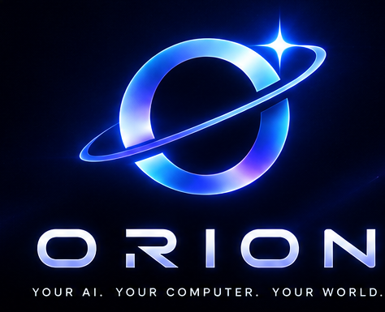
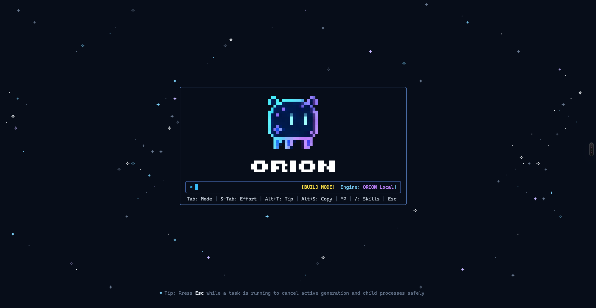

# You tell it. ORION does it.

### Most AI tells you *how* to do something. ORION actually does it — on your computer, with your permission, and proves it worked.

[**Request a demo**](mailto:saqib@impacts-ai.com?subject=ORION%20demo) · [Project page](https://impacts-ai.com/orion) · [iMpacts-AI](https://github.com/iMpacts-AI)

 

---

## The problem

Every day, people lose hours to the *steps* between wanting something and getting it done:
finding the right app, clicking through menus, filling in the same details again, and getting lost in
long online forms. For many people — parents, grandparents, small business owners, anyone facing a
government service for the first time — those steps are the hardest part.

AI chatbots made this better at *explaining*. They didn't make it better at *doing*.

## What ORION does

ORION is an AI agent that operates the computer for you. You say what you want in plain words —
the way you'd say it to a friend — and ORION carries out the steps.

> **"yo, pull up youtube"** → YouTube opens.
> **"look up the best mechanical keyboards for me"** → Chrome opens with the results.
> **"put on some Weeknd"** → the song starts playing.
> **"open notepad and type my shopping list"** → done.

No exact commands to memorise. No menus. Just say it.

## Why it can be trusted

An AI that can act on your computer has to earn trust. ORION is built around three promises:

| | |
| :--- | :--- |
| 🛡️ **You stay in control** | Anything important — deleting, sending, paying — waits for a human to say *yes*. |
| ✅ **It proves its work** | ORION doesn't just *say* "done". It checks that the task really happened, and tells you honestly when it didn't. |
| 🔒 **Private by design** | ORION can run on AI that lives on your own device, so personal information doesn't have to leave it. |

## Where it's going

Today, ORION handles everyday computer tasks. The mission is bigger:

**Zero-bureaucracy.** Long, confusing digital processes — like government applications — turned into
one guided conversation. ORION does the repetitive steps, catches mistakes before they happen, and
stops for a person to approve anything that matters.

ORION is currently being developed for the **UAE Hackathon 2026 — Responsible AI / Smart Government track**.

## Status

ORION is in active development and is not publicly released yet. It runs today on Windows, with
broader platform support in progress. Live demos are available on request.

## Talk to us

Mentors, judges, partners and anyone curious — we'd love to show you ORION live.

📩 **[saqib@impacts-ai.com](mailto:saqib@impacts-ai.com)** · 🌐 **[impacts-ai.com/orion](https://impacts-ai.com/orion)**

---

Built by **Sheikh Mohammed Saqib**, founder of **[iMpact AI](https://impacts-ai.com)** · United Arab Emirates

ORION's source code is private. © 2026 iMpact AI. All rights reserved.

