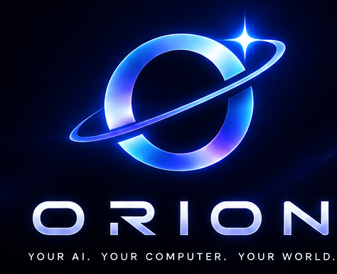

<div align="center">



# ORION

**A controlled computer-use agent built for real workflows.**

Plan clearly. Act through tools. Verify the result.

[Project Website](https://impacts-ai.com/orion) · [iMpacts-AI](https://github.com/iMpacts-AI) · [Issues & Roadmap](https://github.com/iMpacts-AI/ORION/issues)

</div>

---

## What is ORION?

ORION is the flagship project from **iMpacts-AI**, focused on helping people complete multi-step tasks across supported desktop applications and browser workflows.

The engineering goal is not merely to generate a plausible answer or issue a command. ORION is being developed around a controlled execution loop: understand the request, plan the steps, validate tool calls, enforce permissions, perform actions, observe the outcome, and report what actually happened.

ORION is under active development. Capabilities depend on the current implementation, operating system, installed applications, configuration, and permissions.

## Engineering principles

- **Execution over appearance** — a polished interface must sit on top of a working execution path.
- **Verified outcomes** — issuing a command is not proof that the intended result occurred.
- **User control** — sensitive actions require clear authorization; authentication and security prompts remain under the user's control.
- **Honest failures** — distinguish success, failure, cancellation, timeout, denial, and unverified outcomes.
- **Bounded recovery** — retry carefully, avoid loops, and stop when safe progress is not possible.
- **Privacy by default** — never commit credentials or expose private configuration in logs, issues, or documentation.
- **Evidence before claims** — describe compatibility and reliability according to tests and reproducible observations.

## Project areas

The repository contains work related to:

- Agent orchestration and tool execution.
- Desktop application discovery, launching, and window interaction.
- Browser automation and page interaction.
- Permission checks, approval flows, and cancellation.
- Model/provider routing and configuration.
- Task state, diagnostics, and automated tests.
- CLI experience and terminal interaction.

This list describes project areas, not a guarantee that every feature works on every system. Check the relevant implementation, configuration, tests, and known limitations before relying on a workflow.

## Getting started

### Prerequisites

- Git.
- A supported Node.js version for the current project configuration.
- A supported operating system and any dependencies required by the feature you want to use.

### Install

```bash
git clone https://github.com/iMpacts-AI/ORION.git
cd ORION
npm install
```

### Build and test

```bash
npm run build
npm test
```

Run additional checks documented in the repository when applicable. A successful build proves the code builds; it does not by itself prove that desktop actions, browser workflows, or every integration work on your machine.

## Computer-use safety

ORION must operate through its controlled tool and permission path rather than granting a model unrestricted operating-system access. Real-world actions should be validated, permission-checked, supervised, and verified where the available adapter permits it.

- Do not bypass login, multi-factor authentication, account selection, consent, or operating-system security prompts.
- Require user approval for sensitive or consequential actions.
- Keep cancellation available during execution and avoid scheduling new steps after cancellation.
- Report when an application is missing, unsupported, denied, timed out, or launched without a verified outcome.
- Keep credentials in local environment variables or untracked configuration. Never commit secrets.

## Development workflow

1. Inspect the existing execution path before changing architecture.
2. Fix root causes instead of masking errors or adding duplicate execution paths.
3. Add regression tests for bugs and safety boundaries.
4. Run the relevant build, type-check, test, and lint commands.
5. Perform manual smoke tests for OS- and application-specific behavior.
6. Document exact results, limitations, and reproducible steps.

See [open issues](https://github.com/iMpacts-AI/ORION/issues) for active work and known gaps. Contributions and bug reports are most useful when they include reproduction steps, expected versus observed behavior, environment details, and relevant sanitized logs.

## Current status

ORION is actively evolving. It does **not** claim universal compatibility with every desktop application, app store, website, or authentication flow. Browser sessions, app permissions, site-specific behavior, and some user confirmations may require direct user interaction.

Reliability claims should be backed by current tests and repeatable end-to-end evidence—not by mockups, successful compilation alone, or commands that were issued without verifying their effects.

## Links

- [ORION project page](https://impacts-ai.com/orion)
- [iMpacts-AI on GitHub](https://github.com/iMpacts-AI)
- [Report a bug or track work](https://github.com/iMpacts-AI/ORION/issues)

---

Maintained by **iMpacts-AI** · [impacts-ai.com](https://impacts-ai.com)
